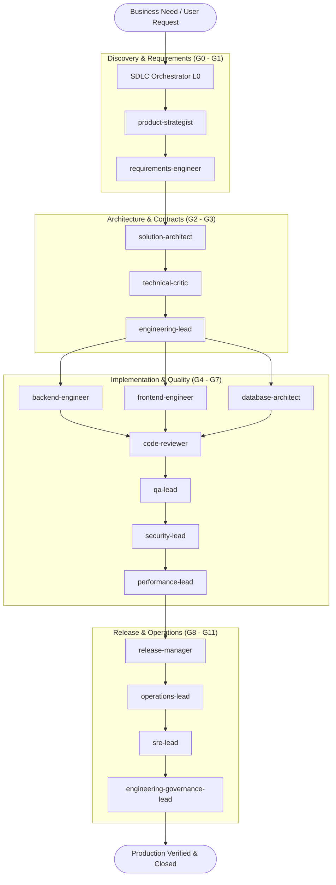

# Agentic SDLC Operating System (Software Factory)

> **Production-Grade AI-Native Software Development Lifecycle (SDLC) Framework for Google Antigravity**

**Agentic SDLC OS** is an orchestration operating system that divides software engineering into **16 specialized domains**, autonomous agents, modular rules, reusable skills, explicit tool permissions, and enforceable quality gates (G0 through G11).

Instead of relying on a monolithic general-purpose model, this framework implements a **hierarchical multi-agent team** where domain leads coordinate specialized workers, red-team critics stress-test architectures, and independent verifiers ensure deliverable quality before production deployment.

---

## Architecture Overview



---

## 1. The 16 SDLC Domains & Agent Catalog

The operating system organizes engineering responsibilities across 16 core disciplines, 7 cross-domain oversight agents, and specialized execution subagents located in `.agents/agents/`:

| Domain | Lead Agent | Responsibilities | Key Quality Gate |
| :--- | :--- | :--- | :--- |
| **1. Strategy** | `product-strategist` | Business case, market research, ROI, value proposition | **G0** Business Approval |
| **2. Requirements** | `requirements-engineer` | PRD/SRS authoring, user stories, acceptance criteria | **G1** Requirements Approval |
| **3. Architecture** | `solution-architect` | System design, domain modeling, ADRs, interface contracts | **G2** Architecture Approval |
| **4. UX/UI** | `ux-design-lead` | User journey flows, component design, WCAG 2.2 AA a11y | Design Specs |
| **5. Delivery** | `delivery-manager` | Sprint planning, WBS, dependency tracking, critical paths | Schedule & Critical Path |
| **6. Development** | `engineering-lead` | Feature implementation, worktree orchestration, peer reviews | **G3** Readiness & **G4** Quality |
| **7. Data** | `data-engineering-lead` | Data modeling, ETL/ELT pipelines, zero-downtime migrations | Migration Safety |
| **8. Quality** | `qa-lead` | Unit, integration, E2E testing, coverage verification | **G5** Functional Quality |
| **9. Security** | `security-lead` | STRIDE threat models, SAST/DAST, SCA, secret scanning | **G6** Security Quality |
| **10. Performance** | `performance-lead` | Latency budgets (p95/p99), resource profiling, load tests | **G7** Performance Quality |
| **11. DevOps** | `platform-engineer` | CI/CD pipelines, IaC (Terraform), Docker, cloud platforms | Pipeline Determinism |
| **12. Release** | `release-manager` | SemVer bumps, changelog generation, rollback runbooks | **G8** Release Readiness |
| **13. Operations** | `operations-lead` | Production deployments, canary/blue-green, smoke tests | **G9** Production Acceptance |
| **14. Observability** | `sre-lead` | RED/USE telemetry, SLO alerting, incident response | **G10** Operational Acceptance |
| **15. Maintenance** | `maintenance-lead` | Refactoring, bug triage, technical debt remediation | Debt Ledger |
| **16. Governance** | `engineering-governance-lead`| Traceability audits, DORA metrics, retrospectives | **G11** Project Closure |

### Cross-Domain Oversight & Specialist Workers
- **`technical-critic`**: Hostile red-team reviewer who stress-tests plans, finds unstated assumptions, and blocks design flaws.
- **`independent-verifier`**: Independent deliverable auditor verifying that acceptance criteria are tested and verified.
- **`traceability-manager`**: Maintains the bidirectional ledger linking requirements to code and tests.
- **`change-impact-analyzer`**: Maps dependency blast radius and ripple effects.
- **`risk-manager`**: Maintains the central technical and delivery risk register.
- **`documentation-governor`**: Prevents doc drift and validates template compliance.
- **`backend-engineer`**, **`frontend-engineer`**, **`database-architect`**, **`unit-test-engineer`**, **`threat-modeler`**, **`incident-responder`**: Specialized execution subagents.

---

## 2. The 12 Enforceable Quality Gates (G0 to G11)

Tasks cannot advance without meeting explicit criteria verified through `scripts/gate_validator.py`:

```
[G0: Business Approval] ────> [G1: Requirements Approval] ────> [G2: Architecture Approval]
                                                                        │
[G5: Functional Quality] <─── [G4: Code Quality Review]  <─── [G3: Implementation Readiness]
       │
[G6: Security Quality]   ────> [G7: Performance Budget]  ────> [G8: Release Readiness]
                                                                        │
[G11: Project Closure]   <─── [G10: Operational Telemetry] <─── [G9: Production Deployment]
```

| Gate | Validation Focus | Required Evidence | Responsible Sign-Off |
| :--- | :--- | :--- | :--- |
| **G0** | Business Feasibility | Product brief in `docs/product/` with KPIs and scope | `product-strategist` |
| **G1** | Requirements Spec | PRD in `docs/requirements/` with testable `REQ-XXX` | `requirements-engineer` |
| **G2** | Architecture & ADRs | Design doc in `docs/architecture/`, ADR in `docs/adr/` | `solution-architect` |
| **G3** | Implementation Readiness| Technical task plan with explicit file modifications | `engineering-lead` |
| **G4** | Code Quality | Clean static analysis, zero swallowed exceptions | `code-reviewer` |
| **G5** | Functional Quality | 100% test pass rate with terminal execution evidence | `qa-lead` |
| **G6** | Security Quality | Zero plaintext secrets, clean SAST/SCA audit | `security-lead` |
| **G7** | Performance Quality | Latency p95/p99 within budget under load | `performance-lead` |
| **G8** | Release Readiness | SemVer bumped, CHANGELOG updated, rollback plan ready | `release-manager` |
| **G9** | Production Acceptance| Zero-downtime deployment, post-deploy smoke tests passed| `operations-lead` |
| **G10**| Operational Telemetry| RED/USE telemetry streaming, SLO alerts armed | `sre-lead` |
| **G11**| Closure & Governance | End-to-end traceability verified, retrospective stored | `engineering-governance-lead` |

---

## 3. Modular Rules Engine (`.agents/rules/`)

Non-negotiable engineering constraints are enforced through 15 modular rule files:

1. `00-core-engineering.md`: Absolute integrity, terminal execution evidence, no hallucinations.
2. `01-sdlc-governance.md`: Quality gate definitions and progression rules.
3. `02-requirements-traceability.md`: Standardized IDs (`REQ-XXX`, `TASK-XXX`, `ADR-XXX`) and backlinks.
4. `03-architecture-standards.md`: Domain-driven boundaries, ADR format, resilience patterns.
5. `04-coding-standards.md`: Readability, type safety, explicit exception handling.
6. `05-api-contracts.md`: Backward compatibility, OpenAPI specs, idempotency.
7. `06-database-standards.md`: Zero-downtime expand/contract migrations, rollback tests.
8. `07-testing-standards.md`: Test pyramid, 85% branch coverage, execution logs.
9. `08-security-baseline.md`: Secret zero, OWASP Top 10, dependency CVE scans.
10. `09-performance-baseline.md`: Latency budgets (p95 < 200ms), no memory leaks.
11. `10-devops-standards.md`: Declarative IaC, container immutability, non-root users.
12. `11-release-governance.md`: Semantic versioning, changelogs, rollback procedures.
13. `12-observability-standards.md`: Structured JSON logging, RED/USE metrics, OpenTelemetry traces.
14. `13-documentation-standards.md`: Code-doc synchronization, template compliance.
15. `14-ai-agent-governance.md`: Least privilege, no self-approvals, safe tool permissions.

---

## 4. Reusable Orchestration Skills (`.agents/skills/`)

Workflows are modeled as progressive Antigravity Agent Skills:

- `product-discovery`: Market analysis and business proposals.
- `prd-generation`: Numbered requirements and acceptance criteria.
- `requirements-validation`: Stress-testing requirements before design.
- `system-design`: Component modeling and Mermaid architecture diagrams.
- `architecture-review`: Red-team architectural challenge and ADR sign-off.
- `feature-implementation`: End-to-end coding, worktree isolation, and review.
- `code-review`: Independent peer review and static analysis.
- `api-development`: OpenAPI contract design, mock generation, client SDKs.
- `database-change`: Schema design, forward/rollback migrations.
- `test-automation`: Automated test suite authoring and execution.
- `security-assessment`: Threat modeling and secret scanning.
- `performance-assessment`: Latency benchmarking and load tests.
- `ci-cd-setup`: Automated build and gate verification pipelines.
- `release-readiness`: Version bumping and release checklists.
- `production-deployment`: Progressive canary/blue-green deployments.
- `incident-response`: Outage triage, containment, and blameless postmortems.
- `technical-modernization`: Safe legacy refactoring and debt remediation.
- `continuous-improvement`: DORA metrics tracking and team retrospectives.

---

## 5. Quickstart & Installation

### Windows PowerShell
```powershell
powershell -ExecutionPolicy Bypass -File scripts/bootstrap.ps1
```

### Linux / macOS
```bash
bash scripts/bootstrap.sh
```

### CLI Tooling Commands

#### Create a Tracked Engineering Task
```bash
python scripts/traceability_cli.py create-task --domain development --title "Implement JWT Authentication" --req REQ-101
```

#### Link Artifacts & Tests
```bash
python scripts/traceability_cli.py link --task TASK-101 --artifact src/auth/jwt.py --test TEST-101
```

#### Validate Quality Gate
```bash
python scripts/gate_validator.py --gate G1 --task TASK-101
```

#### Scan Repository for Plaintext Secrets
```bash
python scripts/security_check.py --stage audit
```

#### Inspect Task Ledger Status
```bash
python scripts/traceability_cli.py status
```

#### Generate Traceability Matrix
```bash
python scripts/traceability_cli.py matrix --output docs/governance/traceability_matrix.md
```

#### Verify Framework Integrity
```bash
python scripts/validate_framework.py
```

---

## 6. Antigravity & Model Context Protocol (MCP) Integration

This framework configures native MCP servers in `.agents/mcp_config.json`:
- `sdlc-traceability`: Enables agents to query task status and register artifacts via MCP tools.
- `sdlc-gate-validator`: Enables agents to run automated gate validations directly.
- `.agents/hooks.json`: Intercepts tool calls before command execution and after file writes to prevent dangerous commands and secret commits.

---

## License
Apache-2.0. See [LICENSE](./LICENSE) for details.
