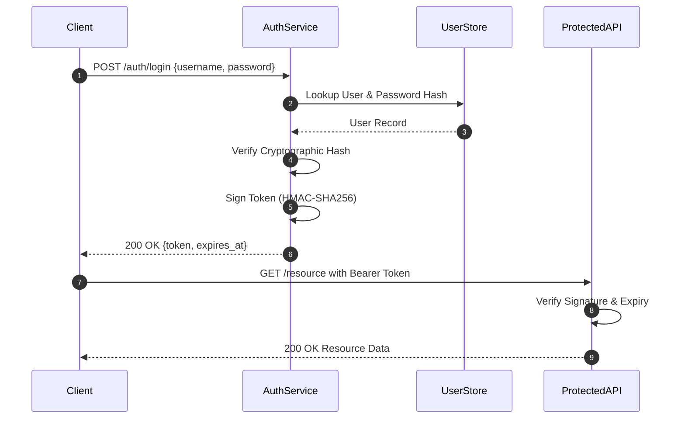

# Architecture Specification: Authentication Service

**Spec ID:** `ARCH-101`
**Title:** Stateless Token-Based Authentication Architecture
**Author:** `solution-architect`
**Reviewer:** `technical-critic`
**Status:** `APPROVED`
**Traces:** `REQ-101`, `REQ-102`

---

## 1. System Architecture Diagram

---

## 2. Component Design & Contracts
- **Token Format:** Base64URL header + payload + HMAC-SHA256 signature.
- **Payload Claims:**
  - `sub`: User identifier
  - `exp`: Expiration timestamp (UTC epoch seconds)
  - `iat`: Issued at timestamp
  - `scope`: Granted permission roles
