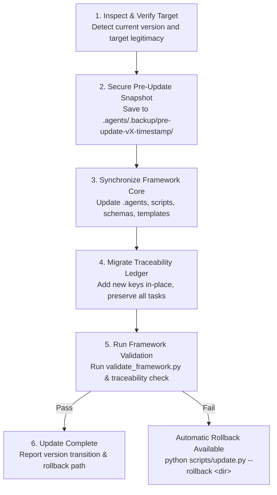

# Agentic SDLC OS — Downstream Project Update Strategy

This document defines the formal lifecycle, boundary architecture, and execution procedures for updating **Agentic SDLC OS** in downstream consumer repositories without overwriting or disrupting project-specific code, documentation, or task histories.

---

## 1. Core Operating Principles

1. **Zero Project Intrusion**: Updates must never modify, overwrite, or delete project application code (`src/`), tests (`tests/`), or project documentation (`docs/` artifacts).
2. **Ledger Immutability & Safe Migration**: A consumer project's `governance/traceability_ledger.json` contains its historical audit trail (tasks, objectives, requirements, and gate approvals). Updates must never replace this file; schema additions must be migrated in-place.
3. **Pre-Update Snapshot by Default**: Every update operation automatically captures a full snapshot of the framework components being modified before writing any changes.
4. **Instant Rollback**: If an update or post-update validation fails, the environment can be rolled back to its exact pre-update snapshot with a single command.
5. **Extension Point Isolation**: Custom rules, agents, and skills residing in designated `custom/` directories are preserved across all updates.

---

## 2. Architectural Boundary: Framework vs. Project Space

```
┌─────────────────────────────────────────────────────────────────────────────┐
│                            CONSUMER REPOSITORY                              │
├──────────────────────────────────────┬──────────────────────────────────────┤
│      PROTECTED PROJECT SPACE         │       MANAGED FRAMEWORK SPACE        │
│    (Never Touched by Updates)        │        (Synchronized & Updated)      │
├──────────────────────────────────────┼──────────────────────────────────────┤
│  src/                                │  .agents/agents/*.md                 │
│    Application code & services       │    Core agent personas (31 agents)   │
│  tests/                              │  .agents/rules/*.md                  │
│    Project automated test suites     │    Core SDLC rules (15 rules)        │
│  docs/ (except docs/templates/)      │  .agents/skills/*                    │
│    ├── adr/                          │    Core workflows (18 skills)        │
│    ├── api/                          │  .agents/*.json                      │
│    ├── architecture/                 │    Manifests & hooks config          │
│    ├── product/                      │  scripts/                            │
│    ├── requirements/                 │    Tooling (CLI, gate validator,     │
│    ├── security/                     │    security check, MCP servers)      │
│    └── testing/                      │  governance/schemas/                 │
│  .agents/agents/custom/              │    Schema definitions                │
│    Project-specific agent personas   │  governance/quality_gates.json       │
│  .agents/rules/custom/               │    Gate exit criteria definitions    │
│    Project-specific rule overrides   │  docs/templates/                     │
│  .agents/skills/custom/              │    Standard markdown templates       │
│    Project-specific skills           │  governance/traceability_ledger.json │
│  Project config & env files          │    *In-place schema migration ONLY*  │
│    package.json, pyproject.toml      │                                      │
└──────────────────────────────────────┴──────────────────────────────────────┘
```

---

## 3. The 6-Step Update Lifecycle

When executing an update (`python scripts/update.py` or installer with `--update`), the updater follows a deterministic sequence:



### Step 1: Target Verification & Version Detection
- Confirms the target directory is an active Agentic SDLC OS project.
- Reads `current_version` from `plugin.json` or `governance/traceability_ledger.json`.
- Fetches the upstream framework release (from GitHub or local repository).

### Step 2: Pre-Update Snapshot
- Captures an immutable backup of all files about to be modified into `.agents/.backup/pre-update-<version>-<timestamp>/`.
- Ensures zero risk of data loss.

### Step 3: Framework Core Synchronization
- Copies updated agent personas to `.agents/agents/` (skipping `.agents/agents/custom/`).
- Copies updated rule files to `.agents/rules/` (skipping `.agents/rules/custom/`).
- Copies updated skills to `.agents/skills/` (skipping `.agents/skills/custom/`).
- Copies updated manifests (`hooks.json`, `rules.json`, `skills.json`, `agents.json`, `mcp_config.json`).
- Updates `scripts/` automation tools.
- Updates `governance/schemas/` and `governance/quality_gates.json`.
- Updates `docs/templates/` (templates only).

### Step 4: Non-Destructive Ledger Migration
- Loads `governance/traceability_ledger.json`.
- Injects any newly introduced top-level collections (`objectives`, `requirements`, `adrs`) if missing.
- Backfills newly introduced traceability fields into existing task records (`objective_id`, `adr_ids`, etc.) without altering existing data.
- Bumps schema `version` to match the framework release.

### Step 5: Post-Update Verification
- Executes `python scripts/validate_framework.py` in the target project.
- Executes `python scripts/traceability_cli.py check` to verify ledger consistency.
- Confirms zero regressions in the target environment.

### Step 6: Summary & Audit Trail
- Outputs detailed transition summary: `v<OLD> -> v<NEW>`.
- Displays rollback command reference.

---

## 4. Execution Commands

### Updating via PowerShell (Windows)
```powershell
# Upgrade current project to latest framework release
powershell -ExecutionPolicy Bypass -File scripts/install.ps1 -Update

# Upgrade specific project directory
powershell -ExecutionPolicy Bypass -File scripts/install.ps1 -Update -TargetDir C:\path\to\project
```

### Updating via Bash (POSIX / Linux / macOS)
```bash
# Upgrade current project to latest framework release
bash scripts/install.sh --update

# Upgrade specific project directory
bash scripts/install.sh --update -t /path/to/project
```

### Updating via Python CLI Directly
```bash
# Standard upgrade
python scripts/update.py

# Upgrade specific target directory
python scripts/update.py --target /path/to/project

# Preview changes without modifying files (Dry-Run)
python scripts/update.py --dry-run

# Rollback to a previous snapshot
python scripts/update.py --rollback ".agents/.backup/pre-update-1.0.0-20261113T054443Z"
```

---

## 5. Handling Custom Extensions & Conflict Prevention

To ensure project-specific additions are never affected by future framework updates:

1. **Custom Agents**: Store custom agent personas in `.agents/agents/custom/<agent-name>.md`.
2. **Custom Rules**: Store project-specific engineering rules in `.agents/rules/custom/<rule-name>.md`.
3. **Custom Skills**: Store custom multi-step workflows in `.agents/skills/custom/<skill-name>/SKILL.md`.
4. **Charter Customizations**: In `AGENTS.md`, place project-specific principles under an explicit section:
   ```markdown
   <!-- PROJECT_CUSTOM_CHARTER_START -->
   ### Project-Specific Engineering Addenda
   ...
   <!-- PROJECT_CUSTOM_CHARTER_END -->
   ```
The updater respects these boundary conventions, ensuring seamless upstream framework evolution alongside continuous downstream application development.
