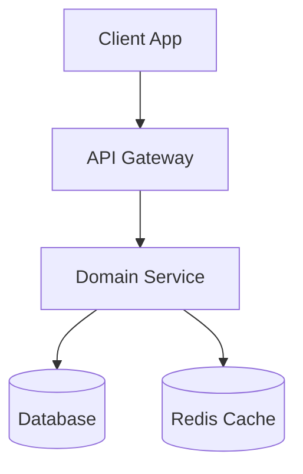
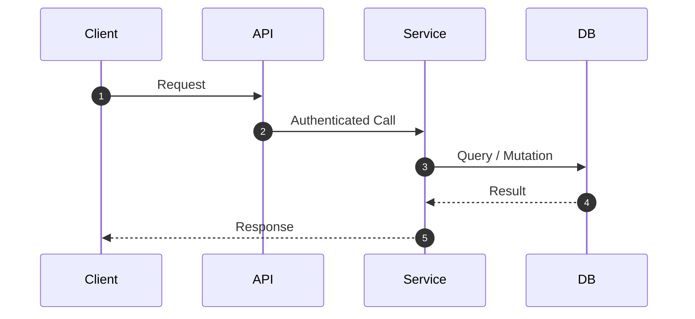

# System Architecture Specification (RFC)

**Spec ID:** `ARCH-<ID>`
**Title:** [System Architecture Title]
**Author:** `solution-architect`
**Reviewers:** `technical-critic`, `security-lead`, `performance-lead`
**Status:** `DRAFT` | `REVIEW` | `APPROVED`
**Traces Requirements:** `REQ-<ID>`

---

## 1. High-Level Architecture Overview
High-altitude summary of system behavior, domain boundaries, and architectural style.

---

## 2. Component Design & Interfaces
Detailed breakdown of internal modules, contracts, and interaction sequence.

---

## 3. Data Storage & Schema Design
- Primary persistence mechanism.
- Entity relational diagram or document structure.
- Partitioning and caching strategy.

---

## 4. Cross-Cutting Concerns
- **Security & Trust Boundaries:** Authentication, authorization, and data encryption.
- **Resilience & Fault Tolerance:** Timeout limits, retry policy, circuit breakers, fallbacks.
- **Observability:** Metrics to expose, distributed tracing spans, alert conditions.
